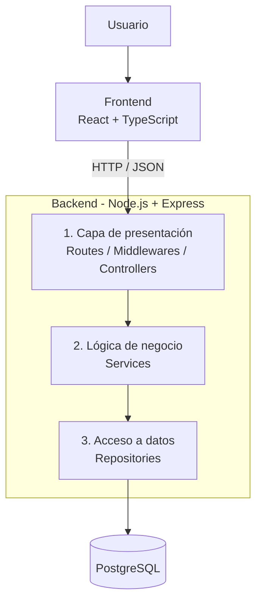
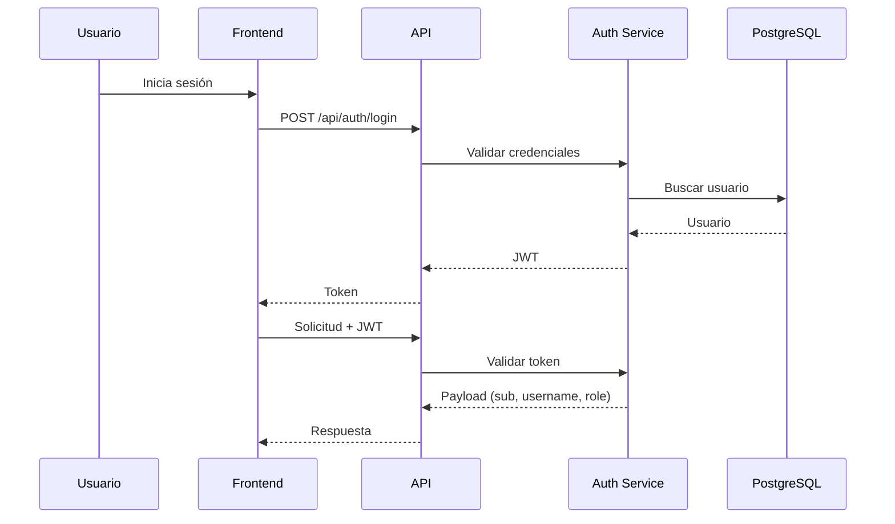

# 11. Arquitectura del sistema

## 11.1 Arquitectura seleccionada

El backend del sistema se organiza en una **arquitectura de tres capas**:

1. **Capa de presentación (API)**
2. **Capa de lógica de negocio**
3. **Capa de acceso a datos**

La capa de presentación es la API del backend, que expone endpoints HTTP a un consumidor: el frontend. El frontend es la interfaz que ve el usuario y se desarrolla como una aplicación React; no forma parte de las tres capas del backend y no debe confundirse con la vista del patrón MVC. Las tres capas describen la organización interna del backend, mientras que el frontend consume esa API desde afuera.

## 11.2 Diagrama general



Express es el framework con el que se construye el servidor HTTP completo, no una capa del backend. Las tres capas se implementan con sus módulos y viven dentro de ese servidor.

## 11.3 Capa 1 - Presentación (API del backend)

Esta capa recibe las solicitudes HTTP que envía el frontend y devuelve las respuestas. Se implementa con Express y se organiza en tres piezas: rutas, middlewares y controladores.

### Routes

Las rutas definen la interfaz HTTP del sistema. Indican el método, la ruta, los middlewares que se aplican y el controlador que responde. Por ejemplo, `product.routes.ts` monta `GET /api/products` y exige autenticación para todo el router, mientras que las operaciones de escritura agregan `authorize("admin")`.

### Middlewares

Los middlewares se ejecutan antes del controlador. En esta capa se resuelven la autenticación, la autorización por rol y el manejo centralizado de errores. El detalle se desarrolla en la sección 11.6.

### Controllers

Los controladores reciben la solicitud, toman los parámetros, el cuerpo y el usuario autenticado, invocan al servicio correspondiente y construyen la respuesta HTTP. La validación de la forma de los datos queda en los validadores que usan los servicios. Los controladores no contienen reglas de negocio: solo traducen entre HTTP y los servicios.

El frontend no forma parte de esta capa. Es el consumidor que envía las solicitudes y presenta las respuestas al usuario.

## 11.4 Capa 2 - Lógica de negocio

La capa de servicios concentra las reglas del sistema.

Ejemplos:

- Comprobar que un producto exista.
- Validar stock suficiente.
- Calcular el total de una venta.
- Actualizar stock.
- Determinar estadísticas.
- Aplicar reglas de baja lógica.
- Coordinar operaciones que involucran varias entidades.

Esta separación evita que las reglas de negocio queden mezcladas con las rutas HTTP o con las consultas a PostgreSQL.

## 11.5 Capa 3 - Acceso a datos

Esta capa es responsable de comunicarse con PostgreSQL, alojado en Neon.

Responsabilidades:

- Consultar, insertar y actualizar registros.

- Aplicar filtros y consultar información relacionada entre tablas.

- Obtener los datos necesarios para las estadísticas.

- Ejecutar las operaciones de persistencia dentro de las transacciones coordinadas por los servicios.

- Concentrar el acceso a la base de datos en los repositorios.

Los servicios definen las reglas del negocio y utilizan los repositorios para acceder a los datos, sin encargarse de los detalles de conexión.

## 11.6 Autenticación y autorización

La autenticación responde quién es el usuario y la autorización qué puede hacer. El sistema las resuelve en dos middlewares distintos, definidos en `apps/api/src/middlewares/auth.middleware.ts`.

### Autenticación



Al iniciar sesión, `authService.login` busca el usuario, compara la contraseña con bcrypt y firma un JWT. El token lleva el identificador (`sub`), el nombre de usuario (`username`) y el rol (`role`). El middleware `authenticate` lee el encabezado `Authorization: Bearer <token>`, llama a `authService.verifyToken` y guarda el contenido en `req.auth`. Si falta el token o no es válido, responde `401 UNAUTHORIZED`. Un usuario deshabilitado no puede iniciar sesión y recibe `403 USER_INACTIVE`.

Mientras PostgreSQL no esté conectado, el repositorio de usuarios es en memoria. La búsqueda del diagrama se resuelve contra ese repositorio y, cuando se conecte la base, el cambio queda acotado a la capa de repositorios.

### Autorización por roles (RBAC)

El modelo es RBAC (control de acceso basado en roles): cada usuario tiene un rol y cada ruta declara qué roles acepta. `authorize(...roles)` se coloca después de `authenticate`; si no hay un usuario autenticado responde `401`, y si el rol no está en la lista responde `403 FORBIDDEN`. Por ejemplo, las mutaciones de productos usan `authorize("admin")` y quedan fuera del alcance de `employee`.

El rol viaja dentro del token. Eso evita consultar la base de datos en cada solicitud, porque `authenticate` solo verifica la firma y la expiración. La contrapartida es que un cambio de rol no se aplica hasta que el token vence (`JWT_EXPIRES_IN`, 8 horas por defecto). Si necesitáramos revocar permisos de inmediato, la alternativa sería enviar solo el identificador en el token y consultar el rol en cada solicitud, a costa de una consulta adicional.

### Endpoints y roles

| Endpoint | Descripción | Roles con acceso | Justificación |
| --- | --- | --- | --- |
| `POST /api/auth/login` | Valida credenciales y devuelve un JWT | Público | Todavía no hay sesión; es la puerta de entrada. |
| `GET /api/auth/me` | Devuelve el usuario del token | `admin`, `employee` | El cliente valida la sesión al recargar. |
| `GET /api/health` | Estado del servicio | Público | Permite verificar disponibilidad sin credenciales. |
| `GET /api/products` | Listado con filtros y paginación | `admin`, `employee` | Ambos roles consultan el catálogo y el stock. |
| `GET /api/products/:id` | Detalle de un producto | `admin`, `employee` | Igual que el listado. |
| `POST /api/products` | Alta de producto | `admin` | El catálogo lo administra el dueño del comercio. |
| `PATCH /api/products/:id` | Edición de producto | `admin` | Cambiar precios, costos o stock es una tarea de administración. |
| `DELETE /api/products/:id` | Baja lógica de producto | `admin` | Dar de baja un producto afecta el catálogo y las ventas futuras. |
| `GET /api/categories` | Listado de categorías | `admin`, `employee` | Se usa en filtros y formularios de productos. |
| `GET /api/tags` | Listado de etiquetas | `admin`, `employee` | Se usa en filtros y formularios de productos. |
| `POST /api/users` | Registro de usuarios (pendiente) | `admin` (a confirmar) | La administración de usuarios queda en manos del administrador. |
| `GET /api/users` | Listado de usuarios (pendiente) | `admin` (a confirmar) | Es información de gestión del comercio. |
| `PATCH /api/users/:id` | Edición de usuarios (pendiente) | `admin` (a confirmar) | Incluye cambios de rol y de estado. |
| `POST /api/categories` | Alta de categoría (pendiente) | `admin` (a confirmar) | Mantiene ordenado el catálogo de productos. |
| `PATCH /api/categories/:id` | Edición de categoría (pendiente) | `admin` (a confirmar) | Afecta la clasificación de los productos. |
| `DELETE /api/categories/:id` | Baja lógica de categoría (pendiente) | `admin` (a confirmar) | Afecta la clasificación de los productos. |
| `POST /api/tags` | Alta de etiqueta (pendiente) | `admin` (a confirmar) | Las etiquetas organizan y filtran el catálogo. |
| `PATCH /api/tags/:id` | Edición de etiqueta (pendiente) | `admin` (a confirmar) | Afecta la clasificación de los productos. |
| `DELETE /api/tags/:id` | Baja lógica de etiqueta (pendiente) | `admin` (a confirmar) | Afecta la clasificación de los productos. |
| `POST /api/sales` | Registro de venta (pendiente) | `admin`, `employee` (a confirmar) | El empleado atiende el mostrador y el administrador puede cubrir el turno. |
| `GET /api/sales` | Historial de ventas (pendiente) | `admin`, `employee` (a confirmar) | Ambos roles necesitan consultar las operaciones del comercio. |
| `GET /api/sales/:id` | Detalle de venta (pendiente) | `admin`, `employee` (a confirmar) | Complementa el historial. |
| `POST /api/sales/:id/cancel` | Anulación de venta (pendiente) | `admin` (a confirmar) | La anulación devuelve stock y altera las estadísticas, por lo que conviene restringirla. |
| `GET /api/stats` | Estadísticas (pendiente) | `admin`, `employee` (a confirmar) | El dueño las usa para decidir; falta definir si el empleado debe verlas. |

> **TODO (equipo):** confirmar los roles de los endpoints marcados como pendientes antes de implementarlos.

## 11.7 Roles

El sistema tiene dos roles y cada uno opera sobre un conjunto distinto de endpoints.

**Admin.** Administra el comercio y los usuarios, mantiene el catálogo de productos, categorías y etiquetas, y puede anular ventas. También consulta productos, stock, historial y estadísticas. En la tabla de 11.6 es el único rol con acceso a las operaciones de escritura del catálogo y a la anulación.

**Employee.** Trabaja en la atención del comercio: registra ventas y consulta productos, stock, categorías, etiquetas e historial. No administra usuarios ni modifica el catálogo, y no puede anular ventas.

El acceso a estadísticas por parte de `employee` queda pendiente de confirmación, tal como figura en la tabla.

## 11.8 Justificación de la arquitectura

La arquitectura de tres capas fue elegida por las siguientes razones:

- **Separa responsabilidades.** La capa de presentación define los endpoints y traduce entre HTTP y los servicios; la capa de negocio valida la forma de los datos, concentra las reglas de stock, totales, bajas lógicas y transacciones; la capa de acceso a datos ejecuta las consultas e inserciones en PostgreSQL. Cada capa se puede leer y modificar sin arrastrar a las demás.
- Facilita el mantenimiento.
- Permite desarrollar frontend y backend de manera independiente.
- Facilita las pruebas.
- Es adecuada para una API REST con Node y Express.
- Se adapta al tamaño y alcance del MVP.
- Es una arquitectura conocida y viable para el equipo.

No se considera necesario utilizar una arquitectura más compleja, como microservicios, para el MVP debido al tamaño del proyecto y a los tiempos disponibles.

## 11.9 Estructura del backend

```text
apps/api/
├── src/
│   ├── config/
│   │   └── env.ts
│   ├── controllers/
│   │   ├── auth.controller.ts
│   │   ├── category.controller.ts
│   │   ├── health.controller.ts
│   │   ├── product.controller.ts
│   │   └── tag.controller.ts
│   ├── errors/
│   │   └── app-error.ts
│   ├── middlewares/
│   │   ├── auth.middleware.ts
│   │   └── error.middleware.ts
│   ├── repositories/
│   │   ├── category.repository.ts
│   │   ├── product.repository.ts
│   │   ├── tag.repository.ts
│   │   └── user.repository.ts
│   ├── routes/
│   │   ├── auth.routes.ts
│   │   ├── category.routes.ts
│   │   ├── health.routes.ts
│   │   ├── product.routes.ts
│   │   └── tag.routes.ts
│   ├── services/
│   │   ├── auth.service.ts
│   │   ├── category.service.ts
│   │   ├── product.service.ts
│   │   └── tag.service.ts
│   ├── types/
│   │   ├── auth.types.ts
│   │   ├── category.types.ts
│   │   ├── express.d.ts
│   │   ├── product.types.ts
│   │   └── tag.types.ts
│   ├── validators/
│   │   ├── product.validator.ts
│   │   └── validation.ts
│   ├── app.ts
│   └── server.ts
├── package.json
└── tsconfig.json
```

## 11.10 Estructura del frontend

```text
apps/client/
├── public/
├── src/
│   ├── components/
│   │   └── products/
│   ├── context/
│   ├── hooks/
│   ├── layouts/
│   ├── pages/
│   │   └── dashboard/
│   ├── services/
│   ├── styles/
│   ├── types/
│   ├── utils/
│   ├── App.tsx
│   └── main.tsx
├── index.html
├── package.json
├── tsconfig.json
├── tsconfig.app.json
├── tsconfig.node.json
├── vite.config.ts
└── eslint.config.js
```
