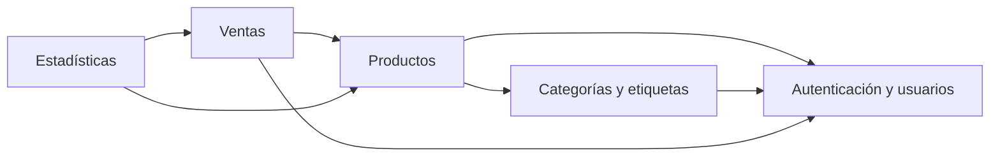

# 12. Módulos del sistema

## 12.1 Módulo de autenticación y usuarios

### Funcionalidades

- Registro de usuarios.
- Inicio de sesión.
- Autenticación mediante JWT.
- Roles.
- Permisos.
- Diferenciación de acceso según el rol.
- Soporte para varios usuarios trabajando sobre la información del mismo comercio.

### Justificación

Este módulo es necesario porque el sistema contempla colaboración entre varias personas de un mismo comercio. La autenticación permite identificar al usuario y la autorización permite determinar qué operaciones puede realizar.

JWT fue seleccionado porque forma parte del stack definido y permite mantener la API REST sin depender de una sesión tradicional del servidor.

### Estado de implementación

La primera iteración del módulo ya está implementada:

- `POST /api/auth/login`: valida usuario y contraseña y devuelve un token JWT.
- `GET /api/auth/me`: devuelve el usuario autenticado a partir del token.
- Middleware de autenticación y de autorización por rol (`admin` / `employee`).
- Contraseñas almacenadas con hash `bcrypt`.
- Usuario administrador por defecto: `admin` / `admin`, configurable mediante
  las variables `ADMIN_USERNAME` y `ADMIN_PASSWORD`.

Mientras PostgreSQL no esté conectado, los usuarios se mantienen en un
repositorio en memoria. El reemplazo por la base de datos solo afecta a la capa
de repositorios, sin cambiar servicios ni controladores.

Pendiente para próximas iteraciones: registro de usuarios (RF-01),
administración de usuarios y refresh tokens. El detalle del plan se encuentra
en [Plan de autenticación](../planificacion/04-plan-autenticacion.md).

---

## 12.2 Módulo de productos

### Funcionalidades

- Alta de productos.
- Consulta de productos.
- Modificación de productos.
- Baja lógica.
- Consulta de stock.
- Definición de stock mínimo.
- Estado activo/inactivo.
- Asociación con una categoría.
- Asociación con múltiples etiquetas.
- Registro de precio de venta.
- Registro de costo.

### Justificación

Los productos constituyen una de las entidades principales del sistema. El módulo centraliza la información necesaria para vender, controlar stock y generar estadísticas.

La baja lógica permite conservar la información histórica sin eliminar físicamente productos que pudieron participar en ventas anteriores.

### Estado de implementación

La primera iteración del backend ya está implementada:

- `GET /api/products`: listado con filtros (`search`, `categoryId`, `tagId`,
  `isActive`, `lowStock`) y paginación.
- `GET /api/products/:id`: consulta de un producto.
- `POST /api/products`: alta de productos (rol `admin`).
- `PATCH /api/products/:id`: modificación parcial (rol `admin`).
- `DELETE /api/products/:id`: baja lógica mediante `is_active` (rol `admin`).
- Validación de categorías y etiquetas contra repositorios sembrados.
- Rutas protegidas con JWT; las mutaciones requieren rol `admin`.

Los productos, las categorías y las etiquetas se almacenan en memoria hasta
conectar PostgreSQL. El CRUD de categorías y etiquetas queda para la siguiente
iteración. El detalle del plan se encuentra en
[Plan de productos](../planificacion/05-plan-productos.md).

---

## 12.3 Módulo de ventas

### Funcionalidades

- Crear una venta.
- Seleccionar productos.
- Registrar cantidades.
- Calcular el total.
- Registrar fecha y hora.
- Registrar usuario responsable.
- Registrar medio de pago.
- Mantener el detalle de los productos vendidos.
- Mantener estado de la venta.
- Actualizar el stock.

### Datos principales

En el modelo relacional, la venta se compone de dos tablas relacionadas:

- **Cabecera (`sales`):** `id`, `number`, `user_id`, `payment_method`, `total`, `status`, `created_at` y los campos de anulación (`cancelled_at`, `cancelled_by`, `cancellation_reason`).
- **Detalle (`sale_products`):** `sale_id`, `product_id`, `product_name`, `quantity`, `unit_price` y `subtotal`.

La cabecera se vincula con el usuario que registró la venta y el detalle se vincula con la cabecera y con cada producto mediante claves foráneas. La escritura de ambas tablas y el descuento de stock se realizan en una misma transacción. El detalle del proceso y el manejo de la concurrencia están en la sección «Actualización del stock» del [modelo relacional](../base-de-datos/01-modelo-relacional.md).

### Justificación

Este módulo es central para el valor agregado de la propuesta. La venta no se almacena solamente como fecha y monto, sino con el detalle de productos.

Esto permite posteriormente:

- Conocer productos más vendidos.
- Calcular facturación.
- Analizar ganancias.
- Actualizar stock.
- Mantener un historial detallado.

---

## 12.4 Módulo de estadísticas

### Funcionalidades

- Cantidad de ventas.
- Facturación.
- Producto más vendido.
- Producto con mayor facturación.
- Producto con mayor ganancia.
- Estadísticas por período.
- Productos con stock bajo.

### Justificación

Las estadísticas representan uno de los principales diferenciadores del proyecto. El objetivo no es solamente registrar información, sino convertir los datos de las operaciones en información útil para la toma de decisiones.

Utilizaremos consultas SQL en PostgreSQL para relacionar la información de las ventas y sus detalles, agrupar los datos por producto o período y calcular los indicadores definidos para el MVP.

El MVP comenzará con indicadores concretos para evitar agregar complejidad innecesaria.

---

## 12.5 Módulo de categorías y etiquetas

### Categorías

Funcionalidades:

- Crear categoría.
- Consultar categorías.
- Modificar categoría.
- Asociar categoría a productos.
- Utilizar categoría como criterio de organización y consulta.

### Etiquetas

Funcionalidades:

- Crear etiqueta.
- Consultar etiquetas.
- Modificar etiqueta.
- Asociar múltiples etiquetas a un producto.
- Utilizar etiquetas como criterios de filtrado.

### Justificación

Las categorías permiten establecer una clasificación principal de los productos, mientras que las etiquetas permiten una clasificación más flexible.

Se utiliza una relación de una categoría por producto y múltiples etiquetas por producto porque un producto puede pertenecer a una categoría principal pero necesitar varios atributos de clasificación.

---

## 12.6 Relación entre módulos

En el diagrama, `A → B` significa que el módulo A utiliza al módulo B. La flecha no representa un flujo de datos ni un orden de ejecución. La actualización de stock no aparece como módulo separado porque es una operación del módulo de ventas sobre los productos.

## 12.7 Procesos críticos

El registro de una venta y su anulación se detallan en [Procesos críticos](../procesos/01-procesos-criticos.md).

## 12.8 Priorización para el MVP

El equipo definió el siguiente orden de implementación:

1. Autenticación y usuarios.
2. Categorías y etiquetas.
3. Productos.
4. Ventas, incluida la actualización de stock.
5. Estadísticas.
6. Integración y pruebas.

El orden sigue las dependencias del diagrama: categorías y etiquetas solo necesitan la autenticación; productos usa categorías, etiquetas y autenticación; ventas necesita productos y usuarios; y estadísticas necesita ventas y productos. La actualización de stock queda dentro de ventas porque es la operación que modifica el stock de productos al registrar o anular una venta, no un módulo aparte.
