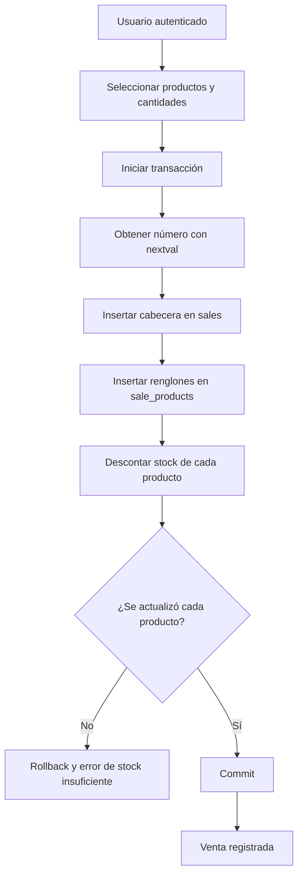
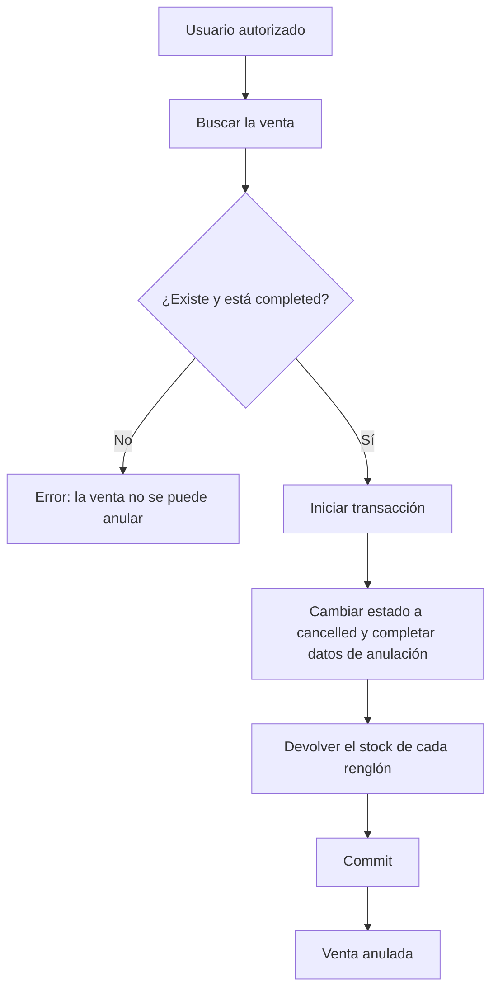

# 13. Procesos críticos

Hay dos operaciones en las que un error deja datos inconsistentes: registrar una venta y anularla. Las dos se resuelven con una transacción que incluye la cabecera, el detalle y el stock. El modelo de las tablas está en [Modelo relacional](../base-de-datos/01-modelo-relacional.md).

## 13.1 Registro de venta



1. El usuario elige los productos y las cantidades. Antes de abrir la transacción se validan los datos de entrada: que el usuario esté autenticado, que la lista de productos no esté vacía y que las cantidades sean enteros positivos.
2. Se inicia la transacción.
3. Se obtiene el número correlativo con `nextval('sale_number_seq')`.
4. Se inserta la cabecera en `sales` con el usuario, el medio de pago, el total y el estado `completed`.
5. Se insertan los renglones en `sale_products`. Cada renglón guarda el producto, la cantidad, el nombre y el precio unitario del momento, y el subtotal calculado.
6. Por cada producto se ejecuta el descuento condicionado:

```sql
UPDATE products
SET stock = stock - :cantidad
WHERE id = :id AND stock >= :cantidad;
```

7. Si alguna actualización no afecta filas, el producto no existe o no tiene stock suficiente. Se revierte la transacción completa y se informa el error de stock (RN-07). La venta y el detalle no quedan guardados. El número que consumió la secuencia no se recupera.
8. Si todas las actualizaciones se aplican, se confirma la transacción.

La resta se hace sobre el stock guardado en la base, no sobre un valor leído antes en la aplicación. Dos ventas simultáneas del mismo producto se serializan: la segunda actualización ve el resultado de la primera. Si el backend leyera el stock, calculara el nuevo valor y lo guardara, dos operaciones concurrentes podrían pisarse y vender más unidades de las disponibles. La condición `stock >= :cantidad` evita el stock negativo y el `CHECK chk_products_stock` actúa como última garantía.

## 13.2 Anulación de venta



1. Se busca la venta y se comprueba que exista y que esté en estado `completed`. Una venta ya anulada no se vuelve a anular.
2. Se inicia la transacción.
3. Se actualiza `sales`: `status` pasa a `cancelled` y se completan `cancelled_at`, `cancelled_by` y `cancellation_reason`.
4. Por cada renglón de `sale_products` se devuelve la cantidad al stock:

```sql
UPDATE products
SET stock = stock + :cantidad
WHERE id = :id;
```

5. Se confirma la transacción.

La devolución del stock se hace en la misma transacción que la anulación para que no quede una venta anulada sin reponer sus productos. Las estadísticas solo consideran las ventas con estado `completed`, así que una venta anulada deja de sumar facturación y cantidades.

La confirmación de que toda anulación debe devolver el stock queda pendiente en el [modelo relacional](../base-de-datos/01-modelo-relacional.md).
